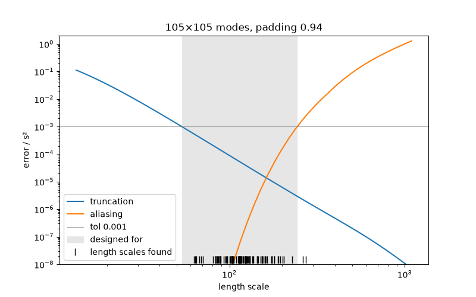

# Geometry and discretisation

A `FourierGP` represents a field by Fourier modes on a box. This page explains
how that box relates to your data, how accurate the field is, and how
spectracles chooses the number of modes for you. To build fields in the first
place, see [Building models](models.md).

```python
import jax
import jax.numpy as jnp
from jax import random

from spectracles import Domain, FourierGP, Matern32, Parameter, SpatialDataGeneric
from spectracles.priors import LogNormal

jax.config.update("jax_enable_x64", True)
```

## Units

spectracles doesn't know about arcseconds or parsecs. Positions can be in any
units, and a field's length scale is in the same units. For LVM data, positions
in arcseconds from the centre of the field are a good choice: length-scale
priors are then in arcseconds too.

A `Domain` is the square region your data cover, in those units:

```python
xy = random.uniform(random.PRNGKey(0), (2, 500), minval=-600.0, maxval=600.0)
spaxels = SpatialDataGeneric(x=xy[0], y=xy[1], idx=jnp.arange(500))

domain = Domain.from_points(spaxels.x, spaxels.y)
print(domain)
```

```text
Domain(centre=(0.9374042496963852, 0.3712791182837236), extent=1198.303547276262)
```

`Domain(centre=(x, y), extent=side)` sets it directly. Several fields can share
one domain.

## Two kinds of error

The field lives on a periodic box: the domain plus a margin of padding on each
side. Its covariance then differs from the kernel's in two ways:

- **Truncation.** The modes stop at a highest frequency, so structure finer
  than the spacing of the mode grid is missing. This matters for **short**
  length scales, and more modes fix it.
- **Aliasing.** The box wraps around, so each point is also correlated with
  copies of the others one box-width away. This matters for **long** length
  scales, and more padding fixes it.

Both are measured relative to the field's variance. The truncation error is an
average over pairs of points spread across the domain; the aliasing error is
the worst pair, since it couples opposite edges of the data.

## Modes chosen for you

Given a domain, a `FourierGP` chooses its own padding and modes, so that both
errors are below a tolerance (0.1% by default) for every length scale between
its prior's 1% and 99% quantiles:

```python
kernel = Matern32(
    length_scale=Parameter(prior=LogNormal(120.0, 40.0)),
    variance=Parameter(prior=LogNormal(1.0, 0.5)),
)
field = FourierGP(kernel, domain=domain)
print(field.n_modes, field.padding)
print(field.design)  # (tol, shortest, longest length scale) it was chosen for
```

```text
(105, 105) 0.94
(0.001, 53.50..., 242.23...)
```

The padding is set by the longest length scale and the modes by the shortest.
Here the padding is large, 0.94 of the extent on each side: the prior allows
length scales up to 242″, a fifth of the domain, and keeping aliasing below
0.1% needs a gap of about ten length scales between the data and their copies.
Fields whose length scales are small compared with the domain need much less.
A wide prior costs modes, padding or both. You can change what the choice is
made for:

```python
FourierGP(kernel, domain=domain, tol=1e-2)  # 1% instead of 0.1%
FourierGP(kernel, domain=domain, length_scale=(60.0, 300.0))  # your own range
FourierGP(kernel, domain=domain, quantiles=(0.05, 0.95))  # a narrower part of the prior
```

or set the modes and padding yourself:

```python
by_hand = FourierGP(kernel, domain=domain, n_modes=(101, 101), padding=0.2)
```

Choosing takes a few seconds per field, once, when the model is built.

## What error would I get?

`discretisation_error` gives both errors for a field as it is, or as it would
be with a different length scale, number of modes or padding:

```python
from spectracles.discretisation import discretisation_error

print(discretisation_error(by_hand))
print(discretisation_error(by_hand, length_scale=40.0).truncation)  # if ℓ were 40″
print(discretisation_error(by_hand, n_modes=51).truncation)  # with fewer modes
print(discretisation_error(by_hand, padding=0.05).aliasing)  # with less padding
```

It works for a kernel before you build any field, too:

```python
e = discretisation_error(kernel, domain=domain, n_modes=101, padding=0.2, length_scale=80.0)
```

An array of length scales gives the errors along it, e.g. for a plot:

```python
import numpy as np

curve = discretisation_error(by_hand, length_scale=np.geomspace(20.0, 1000.0, 30))
curve.truncation, curve.aliasing  # arrays, one value per length scale
```

`required_modes` and `required_padding` answer the opposite question: what does
a given accuracy need?

```python
from spectracles.discretisation import required_modes, required_padding

required_modes(kernel, domain, length_scale=40.0, padding=0.2, tol=1e-3)  # modes per side
required_padding(kernel, domain, length_scale=400.0, tol=1e-3)  # fraction of the extent
```

## Checking a fit

The length scales a fit finds can fall outside the range a field was built for.
`report` checks every field in a model at each sample, at the shortest length
scale found (for truncation) and the longest (for aliasing):

```python
import equinox as eqx

from spectracles import build_model
from spectracles.discretisation import report
from spectracles.inference import LatentSpace


class Map(eqx.Module):
    flux: FourierGP

    def __call__(self, data):
        return self.flux(data)


latent = LatentSpace(build_model(Map, flux=field))
samples = latent.sample_prior_latent(random.PRNGKey(1), n=100)  # stand-in for posterior samples
rows = report(latent, samples)
```

It prints a table with one row per field, and warns if any is above its
tolerance. Here it does: 100 draws from the prior reach beyond its 1%–99%
range, which the field was built for. After a real fit, a warning means the
posterior found length scales the field can't represent accurately; rebuild it
for the range found (`length_scale=(shortest, longest)`). It also takes a `Posterior`, or a model on its own to check its
current values. `plot_discretisation` shows one field's errors against the
length scale, with the length scales found as ticks:

```python
import matplotlib.pyplot as plt

from spectracles.discretisation import plot_discretisation

found = latent.to_params(samples)["flux.kernel.length_scale"]
fig, ax = plt.subplots(figsize=(8, 5))
plot_discretisation(field, length_scales=found, ax=ax)
fig.savefig("discretisation.png")
```



The shaded range is what the field was built for. Truncation (left) is under
the tolerance at its short end, and aliasing (right) at its long end.

## Rules of thumb

With Δ the spacing of the mode grid (the box side divided by the number of
modes) and the gap the distance between the data's far edge and its periodic
copy (twice the padding times the extent), the errors depend only on ℓ/Δ and
gap/ℓ:

| Kernel | 1%: ℓ_min/Δ | 1%: gap/ℓ_max | 0.1%: ℓ_min/Δ | 0.1%: gap/ℓ_max |
|---|---|---|---|---|
| `Matern12` | ≥ 3.0 | ≥ 5 | ≥ 9.6 | ≥ 7 |
| `Matern32` | ≥ 0.88 | ≥ 7 | ≥ 1.64 | ≥ 10 |
| `Matern52` | ≥ 0.58 | ≥ 8 | ≥ 0.90 | ≥ 11 |
| `SquaredExponential` | ≥ 0.92 | ≥ 3 | ≥ 1.13 | ≥ 4 |

Length scales here are spectracles' own: a Matérn kernel's is the textbook
one divided by √(2ν).

## Without a domain

A `FourierGP` without a domain works as in earlier versions: positions must
already lie in [−π, π], the length scale is in those units, there is no
padding, and `n_modes` must be given. The diagnostic still works on it.

## Kernels of your own

Choosing modes, and the diagnostic, need the kernel's continuous form: its
spectral density and covariance (`Kernel.spectral_density` and
`Kernel.covariance`). The built-in kernels have both. For a kernel without
them, give `n_modes` and `padding` yourself.
