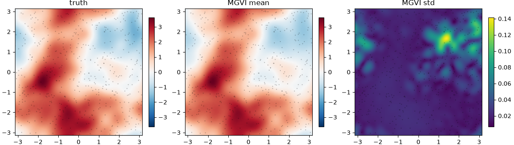
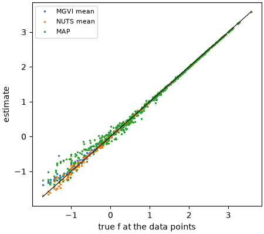

# Fitting a GP field with VI, NUTS and MAP

A complete example of the [priors and inference](../inference.md) workflow, end
to end:

1. Simulate data from a known log-normal field.
2. Fit it with MGVI (NIFTy.re).
3. Fit the *same posterior* with NUTS (BlackJAX) and MAP (optax).
4. Compare the field from the three.

It runs on a laptop CPU in about a minute. The figures on
this page are produced by this code (`docs/examples/make_figures.py`
regenerates them).

## The model and simulated data

A field f(x, y) is a Matérn-3/2 Gaussian process, observed at 500 random points
as d = exp(f) + noise. It is a stand-in for a line-flux map.

```python
import equinox as eqx
import jax
import jax.numpy as jnp
from jax import random

from spectracles import FourierGP, Matern32, Parameter, SpatialDataGeneric, build_model
from spectracles.inference import GaussianLikelihood, LatentSpace, Posterior
from spectracles.priors import LogNormal

jax.config.update("jax_enable_x64", True)


class LogGP(eqx.Module):
    gp: FourierGP

    def __call__(self, data):
        return self.gp(data)


kernel = Matern32(
    length_scale=Parameter(prior=LogNormal(0.6, 0.2)),
    variance=Parameter(prior=LogNormal(1.0, 0.5)),
)
model = build_model(LogGP, FourierGP(n_modes=(15, 15), kernel=kernel))
latent = LatentSpace(model)

N = 500
k_xy, k_truth, k_noise = random.split(random.PRNGKey(0), 3)
xy = random.uniform(k_xy, (2, N), minval=-jnp.pi, maxval=jnp.pi)
points = SpatialDataGeneric(x=xy[0], y=xy[1], idx=jnp.arange(N))


def forward(m):
    return jnp.exp(m(points))


# The truth is a draw from the prior, hyperparameters included
truth = latent.sample_prior_latent(k_truth)
noise = 0.05
data = forward(latent.to_model(truth)) + noise * random.normal(k_noise, (N,))

posterior = Posterior(latent, forward, GaussianLikelihood(data, jnp.full(N, noise**-2)))
```

## MGVI

```python
import nifty.re as jft

from spectracles.nifty import to_nifty

lh = to_nifty(posterior)
n_iterations = 15  # fast in tests: 3
k_init, k_vi = random.split(random.PRNGKey(1))
samples, _ = jft.optimize_kl(
    lh,
    jft.Vector(lh.init(k_init)),
    key=k_vi,
    n_total_iterations=n_iterations,
    n_samples=4,
    sample_mode="linear_resample",  # "nonlinear_resample" for geoVI
    kl_kwargs={"minimize_kwargs": {"maxiter": 20}},
)
posterior.summary(samples, true_latents=truth)  # with the truth, since we simulated the data
```

To see the field, evaluate each sample on a grid:

```python
import matplotlib.pyplot as plt
import numpy as np

n = 100
g = jnp.linspace(-jnp.pi, jnp.pi, n, endpoint=False)
gx, gy = jnp.meshgrid(g, g, indexing="ij")
grid = SpatialDataGeneric(x=gx, y=gy, idx=jnp.arange(n * n))

f_true = latent.to_model(truth)(grid).reshape(n, n)
f_mgvi = posterior.map_samples(lambda m: m(grid), samples).values.reshape(-1, n, n)  # per sample

fig, axes = plt.subplots(1, 3, figsize=(12, 3.4), layout="constrained")
lim = float(jnp.abs(f_true).max())
panels = [
    (f_true, "truth", {"cmap": "RdBu_r", "vmin": -lim, "vmax": lim}),
    (f_mgvi.mean(0), "MGVI mean", {"cmap": "RdBu_r", "vmin": -lim, "vmax": lim}),
    (f_mgvi.std(0), "MGVI std", {"cmap": "viridis"}),
]
for ax, (img, title, kw) in zip(axes, panels):
    im = ax.imshow(np.asarray(img).T, origin="lower", extent=(-np.pi, np.pi, -np.pi, np.pi), **kw)
    ax.plot(xy[0], xy[1], "k.", ms=1, alpha=0.3)
    ax.set_title(title)
    fig.colorbar(im, ax=ax, shrink=0.85)
fig.savefig("inference_fit.png", dpi=100)
plt.close(fig)
```



## NUTS on the same posterior

BlackJAX samples `posterior.log_density` directly, in the same latent
coordinates. Starting from the MGVI mean saves warm-up time. This is a short
run, to show the mechanics. Real NUTS runs on GP models need long chains and
convergence checks (see [How it works](../inference_design.md#hyperparameters-are-the-hard-part)).

```python
import blackjax

n_steps = 200  # fast in tests: 20
k_warm, k_draw = random.split(random.PRNGKey(2))
warmup = blackjax.window_adaptation(blackjax.nuts, posterior.log_density)
(state, params), _ = warmup.run(k_warm, samples.pos.tree, num_steps=n_steps)
nuts_step = jax.jit(blackjax.nuts(posterior.log_density, **params).step)


def one_step(state, key):
    state, _ = nuts_step(key, state)
    return state, state.position


_, nuts_samples = jax.lax.scan(one_step, state, random.split(k_draw, n_steps))
```

## MAP with optax

```python
import optax

optimiser = optax.adam(0.05)
ξ_map = latent.zeros()
opt_state = optimiser.init(ξ_map)


@jax.jit
def step(ξ, opt_state):
    grad = jax.grad(lambda x: -posterior.log_density(x))(ξ)
    updates, opt_state = optimiser.update(grad, opt_state)
    return optax.apply_updates(ξ, updates), opt_state


n_map_steps = 500  # fast in tests: 20
for _ in range(n_map_steps):
    ξ_map, opt_state = step(ξ_map, opt_state)
map_model = latent.to_model(ξ_map)
```

## Comparing the field

All three results are latents of one posterior, so the same `latent` turns each
into a model. Here is the field at the data points:

```python
def field_at_points(m):
    return m(points)


f_nuts = posterior.map_samples(field_at_points, nuts_samples).mean()
f_mgvi_pts = posterior.map_samples(field_at_points, samples).mean()
f_true_pts = latent.to_model(truth)(points)

fig, ax = plt.subplots(figsize=(4.5, 4), layout="constrained")
ax.plot(f_true_pts, f_mgvi_pts, ".", ms=3, label="MGVI mean")
ax.plot(f_true_pts, f_nuts, ".", ms=3, label="NUTS mean")
ax.plot(f_true_pts, map_model(points), ".", ms=3, label="MAP")
lims = [float(f_true_pts.min()), float(f_true_pts.max())]
ax.plot(lims, lims, "k-", lw=0.8)
ax.set_xlabel("true f at the data points")
ax.set_ylabel("estimate")
ax.legend(fontsize=8)
fig.savefig("inference_compare.png", dpi=100)
plt.close(fig)
```



The three methods recover the field consistently. Comparing uncertainties and
GP hyperparameters between methods needs much longer runs than this example; see
[How it works](../inference_design.md#hyperparameters-are-the-hard-part).
