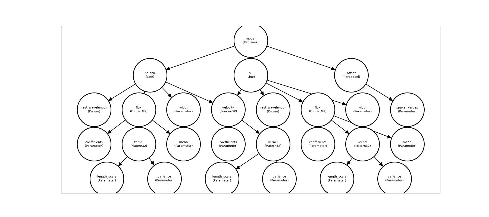

# Building models

A spectracles model is an ordinary [Equinox](https://docs.kidger.site/equinox/)
module. You write a class that holds spectracles components (fields,
per-spaxel terms, parameters) and say in `__call__` how they combine into a
prediction. `build_model` then turns it into a model you can inspect, change
and fit.

This page builds a small two-line model step by step. To fit it, see
[Priors and inference](inference.md).

```python
import equinox as eqx
import jax
import jax.numpy as jnp
import numpy as np
from jax import random

from spectracles import (
    Domain,
    FourierGP,
    Known,
    Matern32,
    Parameter,
    PerSpaxel,
    SpatialDataGeneric,
    build_model,
)
from spectracles.priors import LogNormal, Normal

jax.config.update("jax_enable_x64", True)
```

## Where the data are

A model is evaluated at a set of points on the sky. `SpatialDataGeneric` holds
their positions `x` and `y`, and an index `idx` for each point (usually which
spaxel it is). Here the positions are offsets from the centre of the field, in
arcseconds:

```python
N_SPAXELS = 400
xy = random.uniform(random.PRNGKey(0), (2, N_SPAXELS), minval=-600.0, maxval=600.0)
spaxels = SpatialDataGeneric(x=xy[0], y=xy[1], idx=jnp.arange(N_SPAXELS))
```

The positions can be anywhere: they don't need to lie on a grid. Use whatever
units suit your data; length scales are then in the same units.

A `Domain` describes the region the data cover. Fields use it to work in your
units:

```python
domain = Domain.from_points(spaxels.x, spaxels.y)
```

For LVM data, `SpatialDataLVM` also carries the tile, IFU and fibre of each
point. [lvm_tools](https://tomhilder.github.io/lvm_tools/) builds it for you
from the DRP output: its `FitData.αδ_data` is a `SpatialDataLVM`. See
[LVM data](lvm.md). If your models need something else per point (an exposure number, say),
subclass `SpatialData` and add it:

```python
from equinox import field

from spectracles import SpatialData
from spectracles.model.data import convert_to_flat_array


class ExposureData(SpatialData):
    x: jax.Array = field(converter=convert_to_flat_array)
    y: jax.Array = field(converter=convert_to_flat_array)
    idx: jax.Array = field(converter=convert_to_flat_array)
    exposure: jax.Array = field(converter=convert_to_flat_array)
```

## Fields

A field is a quantity defined continuously across the sky, such as a line flux
or a velocity. `FourierGP` is a Gaussian-process field. It needs a kernel,
which sets how smooth the field is, and the domain:

```python
field = FourierGP(
    Matern32(
        length_scale=Parameter(prior=LogNormal(120.0, 40.0)),  # arcsec
        variance=Parameter(prior=LogNormal(1.0, 0.5)),
    ),
    domain=domain,
)
print(field.n_modes, field.padding)
```

The field is represented by Fourier modes on a box larger than the domain. The
number of modes and the size of the margin are chosen for you, so that the
field is accurate (to 0.1%) for every length scale its prior allows. The
margin grows with the longest length scale, so fields that can vary on scales
close to the size of the domain get a much larger box.
[Geometry and discretisation](discretisation.md) explains the choice, how to
change it, and how to check a fit afterwards.

The kernels are `Matern12`, `Matern32`, `Matern52` and `SquaredExponential`,
from roughest to smoothest. Each takes a `length_scale` and a `variance`.

A field can be evaluated at any points inside the domain, not just where the
data are. That is how you make a dense map after fitting.

### Means and positive fields

A field can have a mean, and a `link` that transforms it. A line flux, for
example, is positive, and often best modelled as the exponential of a GP:

```python
flux = FourierGP(
    Matern32(
        length_scale=Parameter(prior=LogNormal(120.0, 40.0)),
        variance=Parameter(prior=LogNormal(1.0, 0.5)),
    ),
    domain=domain,
    mean=Parameter(prior=Normal(0.0, 1.0)),
    link="exp",
)
```

This field is `exp(GP + mean)`. `link="softplus"` (with `lower=`) is another
positive option, which grows linearly rather than exponentially. The mean is a
parameter like any other, fitted with its own prior.

## Per-spaxel terms

Some quantities don't vary continuously across the sky, such as a calibration
offset for each spaxel.
`PerSpaxel` has one value per spaxel, looked up by `idx`:

```python
per_spaxel = PerSpaxel(N_SPAXELS, Parameter(dims=N_SPAXELS, prior=Normal(0.0, 0.01)))
```

For LVM data there are also `PerIFU`, `PerTile` and `PerIFUAndTile` in
`spectracles.model.spatial`.

## Your model

Now write the model itself. Here, two emission lines share one velocity field,
and each has its own flux field. The rest wavelengths are `Known`: constants
that are never fitted.

```python
C_KMS = 299_792.458


class Line(eqx.Module):
    rest_wavelength: Known
    flux: FourierGP
    velocity: FourierGP
    width: Parameter

    def __call__(self, wavelength, data):
        centre = self.rest_wavelength.val * (1 + self.velocity(data) / C_KMS)
        flux = self.flux(data)
        σ = self.width.val
        return flux / (σ * jnp.sqrt(2 * jnp.pi)) * jnp.exp(-0.5 * ((wavelength - centre) / σ) ** 2)


class TwoLines(eqx.Module):
    halpha: Line
    nii: Line
    offset: PerSpaxel

    def __call__(self, wavelength, data):
        return self.halpha(wavelength, data) + self.nii(wavelength, data) + self.offset(data)
```

A parameter's value is `.val`. Any JAX code can go in `__call__`.

## Building it, and sharing

`build_model` takes the class and its components. To share something between
components, pass the same object to both.

First make the components. There is one velocity field, `velocity`, and a
function that makes a new flux field each time it is called:

```python
velocity = FourierGP(
    Matern32(
        length_scale=Parameter(prior=LogNormal(120.0, 40.0)),
        variance=Parameter(prior=LogNormal(400.0, 200.0)),  # (km/s)²
    ),
    domain=domain,
)


def flux_field():
    kernel = Matern32(
        length_scale=Parameter(prior=LogNormal(120.0, 40.0)),
        variance=Parameter(prior=LogNormal(1.0, 0.5)),
    )
    return FourierGP(kernel, domain=domain, mean=Parameter(prior=Normal(0.0, 1.0)), link="exp")
```

Then build the model. The same `velocity` object goes to both lines, so the
model has one velocity field, not two. Each line gets its own flux field:

```python
halpha = Line(
    rest_wavelength=Known(6562.8),
    flux=flux_field(),
    velocity=velocity,  # shared
    width=Parameter(prior=LogNormal(1.0, 0.2)),
)
nii = Line(
    rest_wavelength=Known(6583.5),
    flux=flux_field(),
    velocity=velocity,  # shared
    width=Parameter(prior=LogNormal(1.0, 0.2)),
)
offset = PerSpaxel(N_SPAXELS, Parameter(dims=N_SPAXELS, prior=Normal(0.0, 0.01)))

model = build_model(TwoLines, halpha=halpha, nii=nii, offset=offset)
```

A shared parameter is fitted once, with one prior. Two separate parameters that
happen to have the same prior, like the two `width`s here, are fitted
independently.

## Fields built from other fields

Two common constructions have their own classes. `FieldFromRatio` writes one
field as another times a ratio, which is useful when the ratio is the quantity
of interest. The ratio is modelled through its base-10 log, and the mean of
that field is the typical log ratio:

```python
from spectracles import FieldFromRatio, FieldPlusScatter

log10_ratio = FourierGP(
    Matern32(
        length_scale=Parameter(prior=LogNormal(200.0, 80.0)),
        variance=Parameter(prior=LogNormal(0.1, 0.05)),
    ),
    domain=domain,
    mean=Parameter(prior=Normal(-0.5, 0.3)),
)
nii_flux = FieldFromRatio(base=halpha.flux, log10_ratio=log10_ratio)  # Hα flux × ratio
```

`FieldPlusScatter(field, scatter)` adds a separate value for each spaxel to a
field, for a quantity with some spaxel-to-spaxel scatter that a continuous
field can't follow:

```python
scattered = FieldPlusScatter(
    field=flux_field(),
    scatter=PerSpaxel(N_SPAXELS, Parameter(dims=N_SPAXELS, prior=Normal(0.0, 0.05))),
)
```

For anything else, such as the sum of two fields, write the arithmetic in your
model's `__call__`.

## Looking at the model

`get_parameter_summary` lists every parameter by its path, with its shape,
prior and whether it is free. A shared parameter appears at every location it
is used, with "Shared from" naming the one place it is stored:

```python
model.get_parameter_summary()
```

`print_model_tree(show_sharing=True)` prints the structure, and
`plot_model_graph()` draws it, with an arrow from each component to what it
uses:

```python
import matplotlib.pyplot as plt

fig, ax = plt.subplots(figsize=(18, 8))
model.plot_model_graph(ax=ax, show=False)
fig.savefig("model_graph.png")
```



Both lines point to the same `velocity` node: it is one field.

## Evaluating

Call the model with a wavelength and the data. To get a spectrum at every
spaxel, map over wavelengths with `jax.vmap`:

```python
wavelengths = jnp.linspace(6550.0, 6600.0, 200)
spectra = jax.vmap(model, in_axes=(0, None))(wavelengths, spaxels)
print(spectra.shape)  # (wavelengths, spaxels)
```

```text
(200, 400)
```

To call a single part of the model, such as the velocity field on a dense
grid, use `for_evaluation()` first. It gives a copy in which shared values are
filled in everywhere:

```python
gx, gy = jnp.meshgrid(jnp.linspace(-600, 600, 100), jnp.linspace(-600, 600, 100))
grid = SpatialDataGeneric(x=gx, y=gy, idx=jnp.arange(gx.size))
velocity_map = model.for_evaluation().nii.velocity(grid).reshape(gx.shape)
```

(Without `for_evaluation()`, `model.nii.velocity` would fail: the shared field
lives at `halpha.velocity`, and `nii` only holds a reference to it.) Use the
copy for evaluation only; keep the original for fitting.

## Setting and fixing values

`set` takes a dict from path to value (an array of the parameter's shape), and
returns a new model:

```python
model = model.set({"halpha.width": jnp.array([1.2]), "nii.width": jnp.array([1.2])})
```

`set_fixed_status` fixes or frees parameters by path. A fixed parameter keeps
its value and isn't fitted:

```python
model = model.set_fixed_status(["offset.spaxel_values"], [True])
```

Priors and fixing can also be set by glob pattern with `with_priors`, e.g.
`model.with_priors({"*.width": LogNormal(1.0, 0.2), "offset.*": "fixed"})`.
[Free, fixed and Known](inference.md#free-fixed-and-known) explains the
difference between the three kinds of parameter.

## Saving and loading

```python
from pathlib import Path

from spectracles import load_model, save_model

save_model(model, Path("two_lines"))
model = load_model(Path("two_lines"))
```

A saved file holds the whole model, including the code of your classes, so it
only loads with the Python and package versions that wrote it. This is likely
to change (see the [roadmap](roadmap.md#saving-fits-rather-than-models)).

## Built-in spectral components

For simple cases you don't need to write the line yourself:
`Gaussian(A, λ0, σ)` is a Gaussian line whose amplitude, centre and width are
each a spatial model, `Constant(c)` is a flat continuum, and
`WindowConstant(c, λ_min, λ_max)` is flat within a wavelength window. See the
[API reference](api/models.md).

## Current limitations

- **Parameters must be attributes**, not items in a list, tuple or dict.
  Putting one in a container raises an error; support is planned for 1.1.
- **`MultiFourierGP`** (several fields evaluated together) is disabled until
  1.1.
- **Fields are stationary**: the kernel is the same everywhere on the sky.
- **Domains are square.** An elongated footprint gets a square box.
- **Choosing modes for you needs the kernel's continuous form**
  (`spectral_density` and `covariance`), which the built-in kernels have. For
  other kernels, give `n_modes` (and `padding`).
